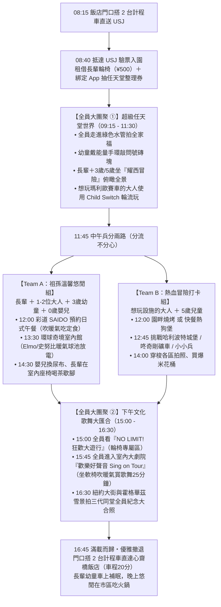

# 日本環球影城（USJ）三代同堂全克服攻略指南
## ── 專為「68歲長輩 ＋ 6名青壯年 ＋ 3歲幼童 ＋ 5歲兒童 ＋ 0歲嬰兒」量身定制的全員圓夢方案

> **文件狀態**：最新制定專屬作戰指南  
> **適用日期**：建議安排於 **2027/03/02（週二，全週客流最低黃金日）** 或 **2027/03/01（週一）**  
> **團體配置**：**9 人全員**（6 成人含 68 歲長輩 ＋ 2 幼童（3歲、5歲） ＋ 1 嬰兒（0–1歲））  
> **核心目標**：克服過去評估中的「身高限制、排隊久站、冬季海風、體力消耗、餐廳排隊、預算過高」六大障礙，讓長輩開懷大笑、小孩盡情放電、年輕人玩到想玩的熱門設施！

---

## 🎯 一、 戰略核心：從「堅決不去」到「全員圓夢」

在先前的景點評估中，USJ 之所以被標註為不適合，主要是因為站在「年輕人特種兵刷設施」的角度，認為 0 歲、3 歲身高不足、冬季海風寒冷、長輩排隊受凍。

然而，**當長輩與家人強烈想去時，旅行的意義就從「刷了多少個雲霄飛車」轉變成「全家三代同堂在超級瑪利歐世界、哈利波特城堡前留下一生難忘的幸福合照」！**

### 💡 轉念後的四大適配心態：
1. **不跟年輕特種兵比速度**：我們不追求一開園狂奔跑百米，我們靠「計程車門對門接駁 ＋ 官方預約系統 ＋ 輪流乘坐 ＋ 精準分流」優雅遊玩。
2. **享受園區氛圍大於極限刺激**：USJ 的世界級造景（瑪利歐的奇幻水管王國、霍格華茲魔法城堡、史努比與小小兵大街）本身就是巨大的沉浸式電影舞台，拍照、漫步、看秀、敲磚塊就是極致享受。
3. **「分流不分心」哲學**：刺激設施讓想玩的年輕人去玩（利用 Child Switch 輪流顧小孩與乘坐）；長輩帶著孫子在室內溫暖館放電、看百老匯級歌舞劇、吃熱騰騰美味定食。
4. **體力保留與安全撤退**：不熬夜到閉園，傍晚 16:30～17:00 見好就收，搭計程車舒服回心齋橋吃溫暖大餐。

### 📊 家族決策必備：「去 vs 不去」關鍵對照表

| 評估維度 | 【方案 A：前往 USJ（安排於 D7 週二）】 | 【方案 B：不去 USJ（改走市區悠閒備案）】 |
|---|---|---|
| **核心吸引力** | • 全家走進「超級任天堂世界」與瑪利歐合影，三代同堂一生難忘。 • 幼童看史努比、NO LIMIT! 大遊行瘋狂放電。 • 青壯年圓夢挑戰咚奇剛礦車與哈利波特。 | • 行程節奏極度鬆弛，毫無早起或排隊焦慮。 • 長輩完全不需長時間走路。 • 悠閒品嚐大阪美食、走訪阿倍野或黑門市場。 |
| **門票與預算** | **全團門票 ＋ 快通分層約 NT$ 28,000～35,000** （3 歲與 1 歲免票！僅需買 6 大 1 兒童票 ＋ 3～4 張快通） | **門票花費約 NT$ 0～5,000** （天保山海遊館/樂高中心或扇町公園/Kids Plaza） |
| **老小體力負擔** | ⭐⭐⭐ **中度（可全數透過技巧克服）** • 長輩租輪椅（¥500/天，走VIP輪椅通道）。 • 雙寶推車防風罩 ＋ 門對門 2 台計程車接駁。 • 傍晚 16:30 見好就收。 | ⭐⭐⭐⭐⭐ **極低負擔** • 悠閒睡到自然醒，下午逛梅田或天王寺百貨，隨時坐咖啡廳休息。 |
| **低溫與海風風險** | 大阪灣 2 月底海風刺骨。需落實「40/30 冷熱交替律」（多進 Elmo 室內暖氣館、Sing 百老匯大劇院避寒）。 | 市區室內商場暖氣充足，無吹風受凍風險。 |
| **後勤與預約難度** | 需 D-60 買票、D-30 搶彩道 SAIDO 日式午餐預約、當日 App 抽整理券與よやくのり。 | 後勤極簡單，免搶快通與園區預約。 |
| **適合推薦情境** | **「若長輩或成人有任天堂情懷、小孩極愛瑪利歐與史努比」**，強烈推薦前往！ | **「若全家只想悠然慢活散步、不想承擔樂園人潮與預約焦慮」**，建議果斷放生改走市區。 |

---

## 👥 二、 9 人成員畫像與體能需求建模

| 成員類別 | 年齡 / 人數 | 核心需求與生理限制 | 園區最佳體驗定位 |
| :--- | :---: | :--- | :--- |
| **長輩** | 68歲（1人） | 膝蓋不耐長時間久站與陡坡；怕吹冷風；喜歡看表演、拍孫子笑臉、吃熱食熟食。 | 坐輪椅無障礙漫遊、室內大劇院（Sing/搖滾秀）、日式彩道定食、看孫子在任天堂敲磚。 |
| **嬰兒** | 0–1歲（1人） | 無法乘坐大部分設施；需按時泡奶、餵副食品、換尿布；極度需要防風保暖。 | 推車防風保暖艙休息、全家福服務處補給、跟著全家漫步拍照、陪同大人使用 Child Switch。 |
| **幼童** | 3歲（1人） | 身高約 92～98 cm；體力約半天需午睡；喜愛史努比、艾蒙、小小兵、瑪利歐。 | 耀西冒險（恐龍車）、環球奇境室內球池、飛天史努比、能量手環打磚塊。 |
| **幼童** | 5歲（1人） | 身高約 105～112 cm（若滿 107cm 可解鎖更多）；精力旺盛，對任天堂與小小兵極度著迷。 | 瑪利歐賽車（滿107cm）、咚奇剛康加鼓、耀西冒險、小小兵冰凍雷射、能量手環小遊戲。 |
| **青壯年** | 6人（含爸媽等） | 承擔推車推動、照顧長幼、操作 App 搶預約；其中部分成員極想體驗熱門大項。 | 輪流照應長幼、利用快通與 Child Switch 挑戰瑪利歐賽車/咚奇剛/哈利波特、負責拍照攝影。 |

---

## 🛡️ 三、 六大不適合痛點：官方系統與實務技巧徹底克服指南

### 克服痛點 1：幼童身高不足，全家被綁住不能玩？
> **【破解神技】：官方「Child Switch（輪流乘坐／交替乘車）」＋ 低門檻設施精選**

#### 1. 什麼是 Child Switch（チャイルドスイッチ）？
這是 USJ 為攜帶幼童家庭提供的官方尊榮服務！**同行大人只需排一次隊，即可輪流乘坐！**
* **操作流程 4 步驟**：
  1. **全員一起到入口**：全家人（包含推車裡的小孩）一起到該設施入口（有快通走快通，沒快通走一般排隊）。
  2. **告知工作人員**：在入口對工作人員說「**Child Switch（チャイルド・スイッチ）**」。工作人員會發給一張專用等待券，並登記乘坐人數。
  3. **第一組搭乘，第二組在專屬休息室等候**：排到接近搭乘區時，工作人員會引導「顧小孩的大人＋小孩」進入**設施內的專屬室內休息室**（有空調暖氣、座椅、電視螢幕）。第一組大人先去搭乘。
  4. **無縫接力，免重新排隊**：第一組玩完回到休息室，第二組大人立刻上前搭乘，**直接從內部通道上車，完全不用重新排隊**！
* **適用設施**：瑪利歐賽車、咚奇剛瘋狂礦車、哈利波特禁忌之旅、飛天翼龍、小小兵瘋狂乘車遊等所有熱門設施！

#### 2. 幼童與長輩能玩的「五星友善設施」盤點：
* **完全無身高限制（幼童能坐穩即可）**：
  * 🦈 **大白鯊™**：乘船漫遊，工作人員逼真演技與水花，長輩幼童皆能坐船同樂。
  * 🧁 **Hello Kitty 夢幻蛋糕杯**：溫和咖啡杯旋轉。
  * 🎭 **全室內大劇院表演秀**：歡樂好聲音（Sing on Tour）、妖魔鬼怪搖滾秀（不限身高，室內暖氣大沙發椅）。
  * 🥳 **NO LIMIT! 狂歡大遊行**：瑪利歐、寶可夢、小小兵巨型花車與舞者巡遊。
* **滿 92 cm 以上（大人陪同，3 歲與 5 歲皆可搭乘！）**：
  * 🥚 **耀西冒險™（超級任天堂世界）**：坐在可愛小恐龍背上，悠閒穿梭於庫巴城堡與長棒山丘，俯瞰整個夢幻瑪利歐王國，速度溫和平穩，**長輩與 3 歲幼童的最愛首選**！
  * 🐶 **飛天史努比**：升降旋轉小飛機，3 歲與 5 歲最愛。
  * 🔫 **小小兵冰凍雷射乘車遊**：旋轉冰壺車，逗趣可愛。
* **滿 107 cm 以上（大人陪同，5 歲幼童若達標可搭乘）**：
  * 🏎️ **瑪利歐賽車～庫巴的挑戰書～**：戴上 AR 眼鏡發射龜殼，沉浸感破表！
  * 🪵 **咚奇剛瘋狂礦車（2024年底最新）**：飛越斷軌礦車，若 5 歲孩子膽大且滿 107cm 可跟大人一起玩；未達標則大人用 Child Switch 體驗。

---

### 克服痛點 2：排隊動輒 90～120 分鐘，長輩站不住、幼童哭鬧？
> **【破解神技】：免費「よやくのり（預約乘坐）」＋ 入口租借輪椅 ＋ 精選快通分層策略**

#### 1. 官方免費神技：「よやくのり（預約乘坐）」
專為「環球奇境（Universal Wonderland）」親子設施設計的**免費快速通道系統**！
* **費用**：**完全免費（¥0）**。
* **操作方式**：入園後打開 USJ 官方 App，將同行門票綁定，點選「よやくのり」，直接選取設施與時段。
* **時間差解鎖秘訣**：一次雖然只能持有一張，但**只要「預約時段開始」的瞬間（例如抽 10:30，當時間跳到 10:30），App 就會立刻解鎖讓您抽下一個設施**！不需等玩完才抽。入園第一張先搶「小小兵冰凍雷射」，第二張抽「飛天史努比」，全程零排隊！

#### 2. 入口租借輪椅（長輩專屬 VIP 神器）
* **租借地點**：入園驗票閘門進來後**右側服務處**。
* **租金**：每日僅 **¥500（約 110 台幣，免稅）**。
* **巨大效益**：
  * USJ 園區道路全部為平整柏油路，各大展館與遊樂設施 100% 具備無障礙斜坡與電梯。
  * 68 歲長輩不必勉強走 15,000 步傷膝蓋，走累了直接坐在輪椅上由晚輩推行，長輩尊榮又舒服。
  * 觀賞大遊行時，工作人員還會貼心引導至**無障礙輪椅專屬觀賞區**，視野極佳免人擠人！

---

### 克服痛點 3：大阪灣 2 月底刺骨海風，戶外受凍？
> **【破解神技】：推車透明保溫艙 ＋ 穴位暖暖包陣法 ＋「40/30 室內外冷熱交替律」**

1. **推車改裝為「無風保溫艙」**：
   * 2 台單人推車**全程裝上透明防風雨罩**，內鋪夾式羽絨保暖毯。透明雨罩能隔絕 99% 的大阪灣寒風，推車內部自成溫室，溫度比戶外高 4°C～6°C，0 歲與 3 歲在裡面完全吹不到風。
2. **長輩貼身暖暖包戰術**：
   * 出門前在長輩與大人發熱衣「大椎穴（後頸下方）」與「命門穴（後腰部）」貼上貼式暖暖包，腳底貼上防寒暖足貼。手握式暖暖包隨身放口袋。
3. **「40/30 分鐘室內外冷熱交替節奏」**：
   * 嚴格禁止全家在戶外連續站立或吹風超過 45 分鐘！
   * 戶外拍照或走動 40 分鐘後，立刻切入**室內避風基地**：
     * 🏠 **環球奇境室內館（Elmo's Playland）**：全室內暖氣、超大型軟墊爬行區、大型球池、泡泡池，3歲放電、0歲爬行、長輩坐在室內軟椅歇腳。
     * 🎬 **歡樂好聲音（Sing on Tour）**：室內大劇院，軟墊劇院椅＋強效暖氣，舒服坐著看 25 分鐘百老匯歌舞秀。
     * ☕ **比佛利山莊法式咖啡店**：點杯熱可可、玉米濃湯，室內坐著聊天。
4. **自備保溫水瓶**：
   * 帶 2 支保溫瓶，在飯店裝滿熱水，隨時給長輩喝溫熱水、泡茶，暖身效果顯著。

---

### 克服痛點 4：中午餐廳大排長龍，老小等位餓肚子？
> **【破解神技】：提前 1 個月搶訂官方「餐廳優先案内（Priority Seating）」**

USJ 熱門餐廳中午動輒排隊 1～2 小時，三代同堂絕對不能排！
* **預約管道**：USJ 官網 / TableCheck 線上預約系統。
* **開放時間**：**用餐日 1 個月前的上午 11:00（台灣時間 10:00）準時開放**。
* **首選推薦餐廳**：
  1. 🍣 **【彩道 SAIDO】（紐約區）── 長輩第一首選！**
     * **風格**：純正日式料理定食。
     * **特色餐點**：豪華壽司御膳、炸蝦天婦羅烏龍麵、熱蒸物、日式牛排定食。
     * **優勢**：有熱騰騰的日式熟食與熱茶，環境優雅安靜，極合台灣長輩胃口，座位寬敞好放推車。
  2. 🥩 **【園畔燒烤 Park Side Grille】（紐約區）── 西式精緻之選**
     * **風格**：美式熟成牛排、義大利麵、濃湯。
     * **特色**：採光極美的復古玻璃屋，環境舒適，服務細緻。
* **超級任天堂世界補給【奇諾比奧咖啡店】**：
  * 若當天在任天堂園區內，一入園就先掃門口 QR Code 領取咖啡店的時段號碼券，時間到了即可進蘑菇屋享用超級瑪利歐漢堡、問號磚塊提拉米蘇！

---

### 克服痛點 5：門票＋快通花費高昂，性價比低？
> **【破解神技】：善用「4歲以下免費入園」＋「快通分層精準購買」省下一半費用**

#### 1. 年齡免票紅利：
* **日本環球影城規定：未滿 4 歲兒童免費入園！**
* 本團成員中：
  * **3 歲幼童**：**免費（¥0）**
  * **0–1 歲嬰兒**：**免費（¥0）**
* **全團 9 人，實際只需要買 7 張門票（6 成人 ＋ 1 兒童票給 5 歲）**！

#### 2. 快通不需買 9 張（分層購買法）：
* **千萬不要買 9 張快通！** 長輩、嬰兒與 3 歲幼童根本不能也不會坐雲霄飛車，買了純屬浪費。
* **最佳購買方案**：
  * 只需為「最想玩刺激熱門設施的 3～4 位成人」購買 **Express Pass 4**（包含瑪利歐賽車、哈利波特、咚奇剛等）。
  * 配合 **Child Switch**，這 3～4 位大人玩完後，可以交替換另外 2 位大人免費進去玩，所有想玩的大人都能玩到，快通預算直接省下 **60% 以上**！
  * 長輩與幼童專攻：よやくのり（免費）、大白鯊（排隊短）、耀西冒險（可單獨抽整理券或排隊）、大劇院表演（無需快通）。

---

### 克服痛點 6：轉乘地鐵人擠人、推車上下月台折騰？
> **【破解神技】：心齋橋飯店門口「2 台計程車門對門直送」**

* 從心齋橋搭地鐵需走地下道、轉阪神難波線再轉 JR 夢咲線，9 人推著 2 台推車在上班人潮中穿梭極耗體力。
* **最佳解法：叫 2 台排班計程車（或 Uber / GO App）**：
  * **出發時間**：早晨約 07:45 在飯店大廳集合，門口上車。
  * **車程時間**：僅約 **18～22 分鐘** 直達 USJ 計程車站！
  * **單趟車資**：每台車約 ¥3,500～¥4,200（約台幣 800 元），兩台合計約 1,600 台幣。
  * **效益**：平均一人車資不到 180 元台幣，長輩與嬰兒在暖氣車廂內舒舒服服補眠，下車直通影城售票大門，將 100% 精力完整保留給樂園！
  * **回程**：傍晚在 USJ 計程車排班處直接上車，原路送回心齋橋飯店，免除提著戰利品擠電車之苦。

---

### 克服痛點 7：0 歲嬰兒泡奶、換尿布與突發照護？
> **【破解神技】：善用三大「全家福服務處（Baby Care Centers）」**

* **三大全家福服務處位置**：
  1. **入園大門驗票口右側（遊客服務處旁）**
  2. **環球奇境（Universal Wonderland）內部中央**
  3. **舊金山區（急救站旁）**
* **設施配備**：
  * **免費 70°C 以上調奶專用純淨熱水機**（泡奶免自備熱水）。
  * **嬰兒副食品專用微波爐**。
  * **獨立私人哺乳室**（隱私舒適、沙發哺乳椅）。
  * **多座乾淨嬰兒尿布更換台與洗手槽**。
* **常設洗手間**：園區內 100% 的男女化妝室皆設有折疊式尿布更換台，爸爸媽媽隨處皆可輕鬆換尿布。

---

## 🗺️ 四、 9 人「分流不分心」編組與動線規劃

為了避免 9 個人整天像拔河一樣互相拖拉，採取「分工分流、核心匯合」戰略：

---

## 🎢 五、 設施分級適配一覽表

針對本團 9 人，設施適合度分為四級：

### 🟢 綠燈：全員皆宜 / 祖孫極致推薦（零刺激、室內、極舒適）
1. **歡樂好聲音巡迴演唱會（Sing on Tour）**：全室內、百老匯級劇院座椅、巨星動物歌舞、暖氣充足，長輩幼童看完全程笑嘻嘻。
2. **大白鯊™**：乘船導覽，長輩免走路、小孩看大白鯊躍出水面刺激有趣。
3. **耀西冒險™（任天堂園區）**：溫和緩慢的小恐龍騎乘，穿越巨大水果與金幣，三代同堂同乘拍照超美。
4. **環球妖魔鬼怪搖滾樂表演秀**：全室內豪華歌舞秀，舒適坐看 30 分鐘經典搖滾。
5. **NO LIMIT! 狂歡大遊行**：瑪利歐、寶可夢、小小兵巨型花車狂歡，小孩隨音樂起舞。

### 🟡 黃燈：幼童專屬放電天堂（家長輪流陪同、長輩坐看）
1. **飛天史努比**（滿92cm）：經典旋轉飛機，可用「よやくのり」免排隊。
2. **小小兵冰凍雷射乘車遊**（滿92cm）：旋轉滑冰壺車，可用「よやくのり」免排隊。
3. **艾蒙泡泡遨游 / 莫匹氣球之旅**（環球奇境）：溫和安全的小型騎乘。
4. **艾蒙想像力樂園（室內巨型球池與軟墊爬行區）**：0歲爬行、3歲丟球、長輩室內吹暖氣坐著看。

### 🔴 紅燈：熱門刺激設施（大人組專攻，使用快通 ＋ Child Switch）
1. **瑪利歐賽車～庫巴的挑戰書～**（滿107cm，戴AR眼鏡）
2. **咚奇剛瘋狂礦車**（滿107cm，斷軌過山車）
3. **哈利波特禁忌之旅™**（滿122cm，4D體感過山車）
4. **小小兵瘋狂乘車遊**（滿102cm，室內4D動態模擬）
5. **飛天翼龍**（滿132cm，超刺激懸吊過山車，僅限大膽大人挑戰）

---

## 📅 六、 在 8 天 7 夜總行程中的最佳日期決策

原行程架構中，後五晚宿大阪心齋橋。我們審視 2/26（五）～ 3/02（二）的大阪日程：

### 🏆 最推薦入園日：**Day 7 ── 2027/03/02（週二）**
* **理由 1【客流量全週最低】**：
  * 根據日本各大樂園混雜度統計，**週二是一週之中遊客最少、排隊時間最短的黃金日**（避開了週五、週六、週日的狂暴人潮，以及週一的修學旅行與補假人流）。
  * 許多熱門項目的排隊時間比週末縮短 40%～60%！
* **理由 2【新成員已充分休息】**：
  * 第 9 位成員在 D4（週六）抵達，經過 D5（草莓園郊區包車）與 D6（市區輕散策）後，體力與時差完全調適完畢，全員以最佳狀態出征樂園！
* **理由 3【不影響最後一天返台】**：
  * D7 傍晚 16:45 準時撤退回心齋橋，晚上整理行李，隔天 D8 悠閒退房搭機，節奏平穩流暢。

> **備選日期**：若考量 D7 想要更輕鬆購物，亦可安排於 **Day 6 ── 2027/03/01（週一）**，替換原定的天保山樂高樂園（因為天保山樂高本來就是作為 USJ 的替代備案）。

---

## 🎒 七、 必備物資與行前作戰 Checklist

### 1. 行前 60 天～30 天關鍵搶票時程
- [ ] **D-60（出發前 2 個月）**：購買入園門票（6 大 1 兒童票，3 歲與 0 歲免票）＋ 購買 3～4 張 Express Pass（熱血大人專用）。
- [ ] **D-30 上午 10:00（台灣時間）**：準時上 TableCheck / 官網預約 **【彩道 SAIDO】** 優先案內（午餐時段 12:00～13:00，備註 9 人含幼兒）。
- [ ] **D-7**：全員手機下載 **日本環球影城官方 App（USJ Official App）**，將門票 QR Code 掃描綁定至主揪手機中，方便入園秒抽任天堂整理券與よやくのり。

### 2. 當日隨身裝備清單
- [ ] **2 台單人輕便推車** ＋ **透明全罩式防風雨罩（2個）** ＋ **推車夾式羽絨保暖毯**
- [ ] **1 條人體工學嬰兒背巾**（排隊換手或室內抱嬰兒必備神器）
- [ ] **保溫水瓶（2支）**：出門裝滿溫熱水，隨時溫潤喉嚨
- [ ] **保暖三寶**：毛帽、防風手套、防風圍巾（海風大時保命）
- [ ] **貼式暖暖包（每人 2 片）** ＋ **手握式暖暖包（大人隨身）** ＋ **暖足貼**
- [ ] **大容量行動電源（2台）**：樂園內全程開 App 查看地圖與預約，非常耗電
- [ ] **幼童零食小餅乾／米餅**：排隊或等待時安撫情緒最佳法寶
- [ ] **備用長褲與衣物 1 套**：防範幼童尿布漏尿或打翻飲料

---

## 🌟 總結結語

三代同堂造訪日本環球影城，絕對不是「受罪」，而是一場**高度考驗後勤智慧的幸福盛典**。

只要我們掌握：
1. **「計程車門對門」** 避開通勤折磨；
2. **「輪椅＋推車」** 解決長輩與雙寶的雙腳負擔；
3. **「Child Switch ＋ よやくのり」** 免除漫長排隊痛苦；
4. **「彩道日式定食預約 ＋ 室內溫暖大劇院」** 徹底阻絕海風低溫；
5. **「未滿4歲免門票 ＋ 快通分層購買」** 精準控管預算。

長輩看著孫子在超級瑪利歐世界歡呼雀躍，年輕人體驗到全球頂尖的遊樂設施，全家一起拍下滿滿笑容的三代全家福——**這份記憶，將會成為全家族未來數十年最溫暖、最珍貴的共同話題！**
